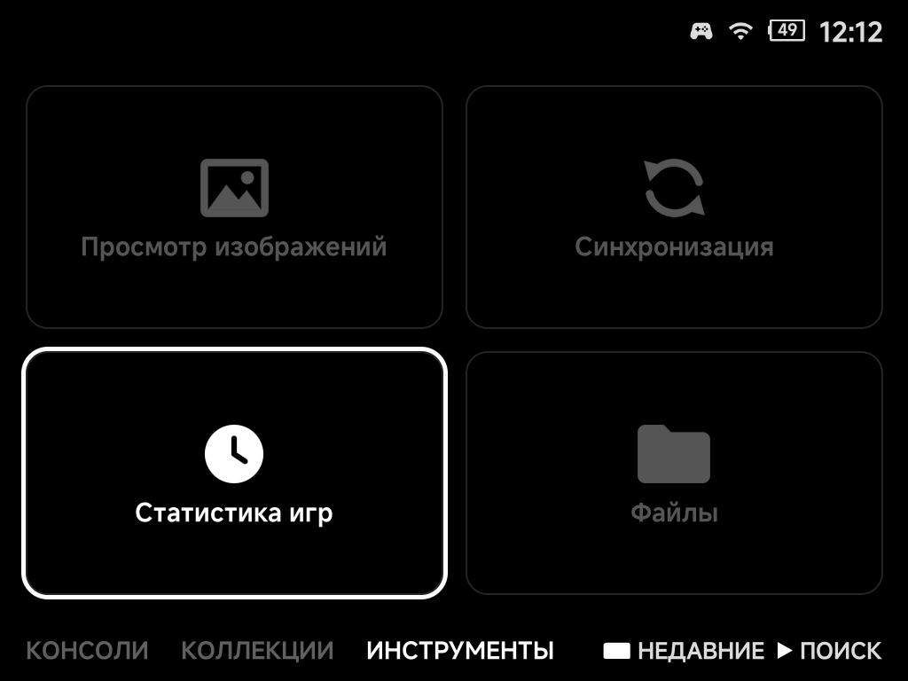
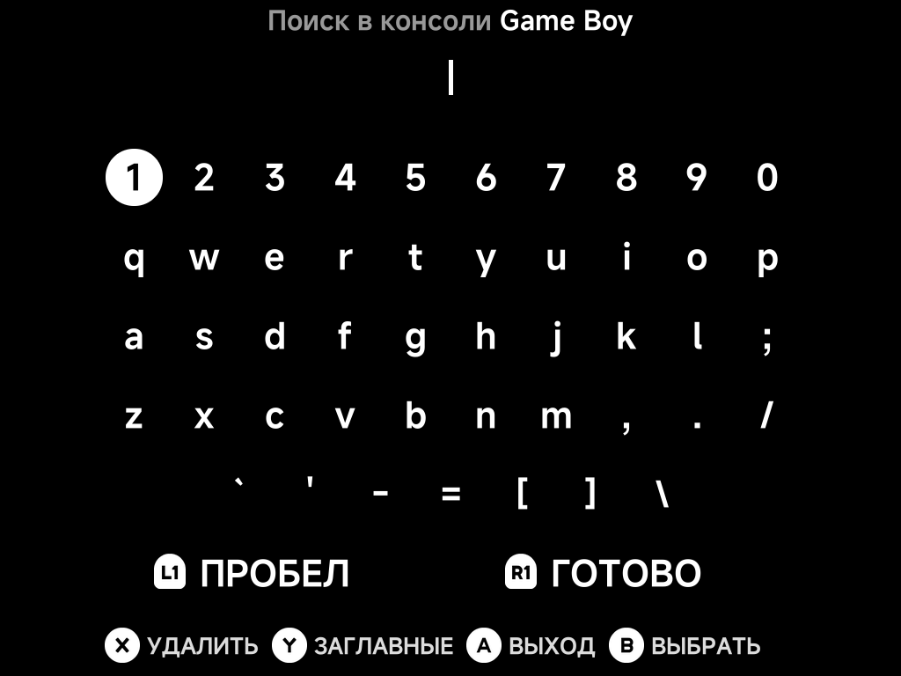
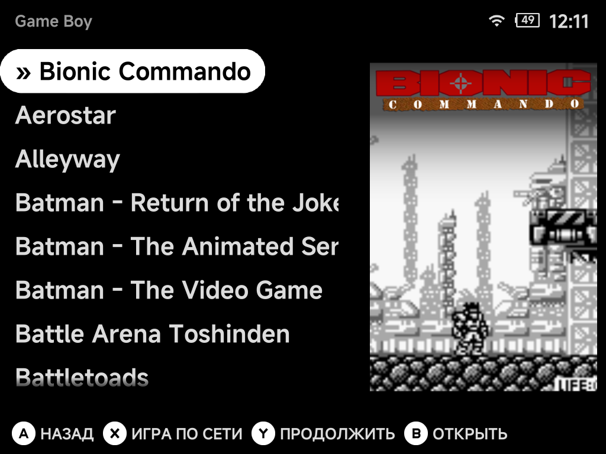
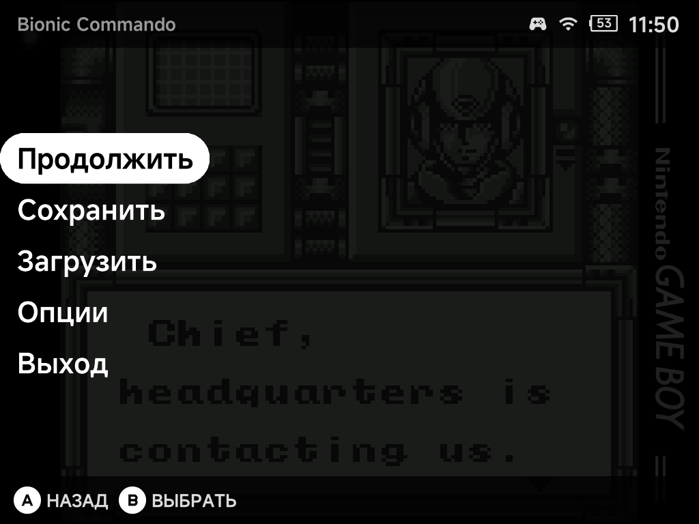
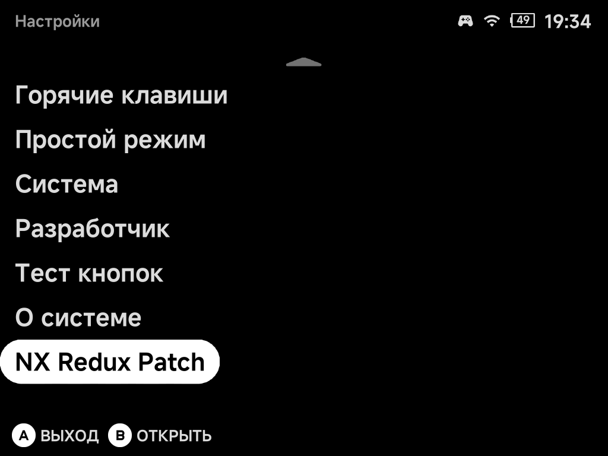
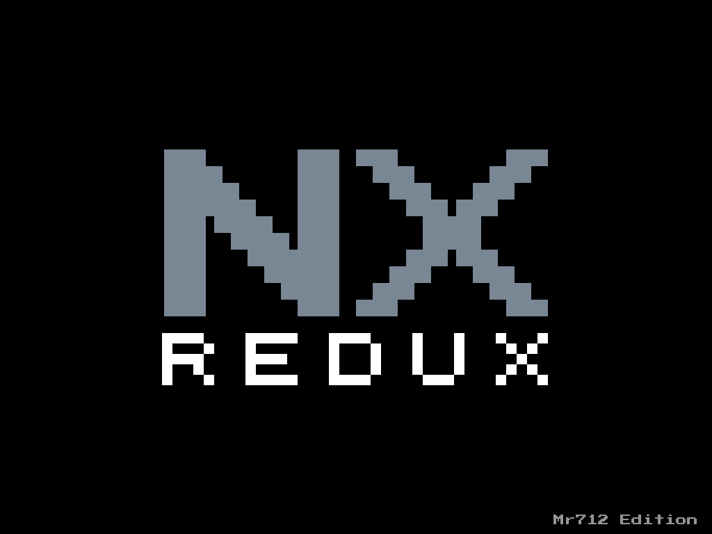

> **Language:** [Русский](README.md) · English

# NX Redux Patch


A patch for **NX Redux on the TrimUI Brick Pro** that translates the interface into Russian, replaces the boot logo and adds a few menu improvements. The patch is applied on the fly to the already installed `nextui.elf` / `settings.elf` and can be removed just as easily.

| Patcher menu | Main screen |
| :---: | :---: |
|  |  |

## What Does This Patch Do

- Boot logo changed.
- Firmware translated into Russian.
- The on-screen keyboard gets button control for "ПРОБЕЛ" (Space) and "ГОТОВО" (Confirm) as L1 and R1 respectively.
- Search within a specific console's game list: in a game list press **MENU** and choose **"Поиск игр по консоли"**.
- Continue where you left off on each console. The first row in a game list is the game you played last on that console.
- The Tools list scrolls through the top and bottom edges (wrap-around).
- The patcher is an **NX Redux Patch** row at the very bottom of **Settings** — start, install and remove from there; the Tools shortcut disappears after the first run.

## Screenshots

Every image is a full 1024×768 console screen, not a crop.

### Main screen and tools

| Main screen | Artwork Manager |
| :---: | :---: |
|  |  |

| Device Sync | Game menu |
| :---: | :---: |
|  |  |

The Tools, Consoles and Collections grids wrap: down on the last row goes to the first, up on the first row goes to the last.

### Search within a console

| Keyboard | Results |
| :---: | :---: |
|  |  |

### Continue row



### In-game menu

| Main menu | Options |
| :---: | :---: |
|  |  |

| Frontend | Shortcuts |
| :---: | :---: |
|  |  |

### Settings

| Settings | Layouts |
| :---: | :---: |
|  |  |

The patcher sits at the very bottom of **Settings** — installing and removing the translation starts there:



### Boot logo and patcher

| Boot logo | Patcher menu |
| :---: | :---: |
|  |  |

## Compatibility

- Device: **TrimUI Brick Pro**.
- Firmware: **NX Redux 2.5.1**.
- The patch works with the **installed** binaries.

## Installation

1. Extract the folders from the [downloaded archive](https://github.com/byMr712/NXPatch-TrimuiBrickPro/releases) into the **Tools** folder on the card with NX Redux — next to `PortMaster.pak` you get:
   ```
   NX Redux Patch.pak/   the shortcut for the first run
   .nxredux/             the patcher itself
   ```
   The archive also contains `Инструкция_Manual.txt` with the same note.
2. Insert the card into the console and power it on.
3. Open **Tools → NX Redux Patch**.
4. The patcher adds an **NX Redux Patch** row at the very bottom of **Settings**. The Tools shortcut stays for now and goes away once the patch is installed.
5. Choose **Install patch** and confirm.
6. Wait for "Done" and reboot.

From then on the patcher starts from **Settings** (the bottom row). The row stays after removing the translation, so the patch can be reinstalled at any time.

> In Simple Mode the Tools tab is hidden — turn Simple Mode off first.
> A firmware update replaces the settings app and the row disappears: extract the archive again and the Tools shortcut comes back.
> If the previous Ports-based version is still on the card, its files are cleaned up on the first install — the backups are carried over into the pak.

Safety: the first run stores `nextui.elf.before`, `settings.elf.before` and `minarch.elf.before`; the rollback uses them.

## Removal

1. Open **Settings** and pick **NX Redux Patch** at the bottom.
2. Choose **Remove patch**.
3. Reboot.

Everything the patch adds is rolled back: the official `nextui.elf`, `settings.elf` and `minarch.elf`, the original boot logo, the Russian tool names (`Tools/map.txt` goes back to your own file or is deleted) and the logo the patch added to the Settings list. Only the **NX Redux Patch** row at the bottom of Settings stays, so the patch can be installed again from there.

## How It Works (For Developers)

The patch does not rebuild NX Redux; it edits machine code inside the ELF files.

### String relocation

`nxpatch` (AArch64, static) finds the original string in `.rodata` by content, copies the translation into a new RX segment (the "cave") and rewrites every reference:

- `ADRP + ADD` pairs (including chained `ADD`s and non-chained `add Xd, Xbase, #imm`);
- eight-byte pointers in string tables.

The original strings stay in the file, which is why English labels are still visible in `strings`, while the interface already uses the Russian ones. Patched files are marked with `Mr712RU`; applying the patch twice returns code 2 ("already patched").

### Tool names

The Tools tab names are not compiled into the binary: NX Redux reads them from `Tools/map.txt` on the card. The installer appends rows for the stock paks (`Artwork Manager.pak` → `Менеджер обложек`, etc.), keeping the original file as `map.txt.bak`; removal restores it (or deletes the file if it did not exist). This works on a clean card and on top of your own renames.

### In-game menu (`minarch.elf`)

The MENU overlay is drawn by the shared frontend `minarch.elf` in `.system/bin`, not by NX Redux. The patch translates its strings with the same `nxpatch` (a separate `minarch.tsv`), keeping the original as `minarch.elf.before`; removal restores it.

The Frontend, Shaders, Controls and Shortcuts submenus are translated inside. For strings that double as config keys, a separate `minarch_display.tsv` table swaps only the display pointers (`labels`, shortcut names, `button_labels`); the stored values stay English, so settings and button bindings keep working and a stock build can read the configs after removal. "Core Options" is the exception: only its title is translated, the items and values come from the core. The Controls button names (A Button, A Turbo, ...) also come from the core and stay as reported.

### Relative dates ("Today", "Yesterday")

With LTO, GCC turns `snprintf(dst, 64, "Today")` into a fixed `strlen+1` copy, so a longer Russian string would be cut to "Сег". `nxpatch` finds the five sites (`Today`, `Yesterday`, `Last week`, `Last month`, `Last year`) by signature and replaces the copy with a call to a NUL-terminating helper; the report says `date copies 5`.

### Truncated menu labels

The compiler expands `snprintf(dst, 64, "%s", "literal")` into a fixed-length copy of `strlen(literal)+1` bytes. After replacing the literal with a longer Russian string, the label was cut in the middle of a UTF-8 sequence. `nxpatch` recognizes such copies by their shape (coverage exactly `strlen+1`, the item `id` stored at offset `0x40`) and replaces them with a call to a small helper in the cave that copies up to NUL.

### Grid wrap-around

The grid input handler contains two "stop" branches (up on the first row and down on the last row). Both are redirected to cave stubs that compute the new index and return into the common selection path. The site is found by a ten-instruction signature; on a mismatch the step is skipped.

### Console search and the "Continue" row

Both live in the same cave and are wired in through hooks on the list handler:

- **search** — a game-menu item opens the keyboard; the matches are collected
  into a regular `Directory`. Back from the results returns to the search
  prompt with the previous query; back again returns to the game list.
  Details and addresses: [docs/console_search.md](docs/console_search.md);
- **"Continue"** — the first row of a console list: that console's newest game
  from Recents. A launches it the same way Recents does (loading the save state
  when there is one). Details, measurements and pitfalls:
  [docs/continue_row.md](docs/continue_row.md).

Screenshots of the keyboard and results are in the [Screenshots](#screenshots) section.

### Patcher menu

`mr712menu` is a small SDL2 application that draws pre-rendered BMP frames. The button layout and hint labels are read from `minuisettings.txt` (`buttonlayout`, `hintlabels`), so the menu follows the system settings instead of assuming an Xbox pad.

## Limitations

- Code patches (grid wrap, console search, the "Continue" row) are tied to a specific NX Redux build. After a firmware update, run the patch again: if the signature does not match, that step is skipped without any side effects (the log shows `grid wrap 0`, `console search 0`).
- The translation and the artwork are version independent and apply to any suitable binary.
- The patch does not touch saves, game lists, collections or user settings.

## Repository Layout

```
port/    ready-to-use set for the SD card: Tools/NX Redux Patch.pak + Tools/.nxredux
tools/   sources: nxpatch.c, mr712menu.c, translation tables, helper scripts
docs/    technical notes and plans
images/  screenshots used by the READMEs
```

The tools are cross-compiled for `aarch64-linux-musl`; the ready binary `nxpatch` is already inside `port`.

## Credits

The original interface and firmware belong to the [NX Redux](https://github.com/nx-redux/nx-handheld) project. This repository contains none of its binaries and changes nothing on the card without an explicit user command.

## License

This project is licensed under the **Apache-2.0 License**.
