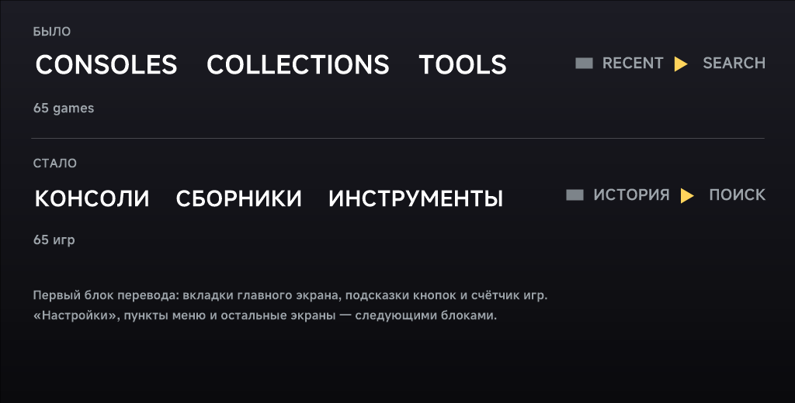
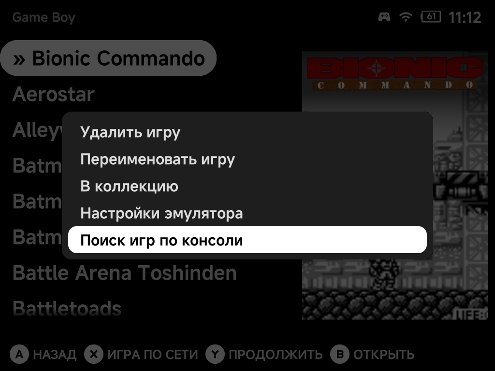
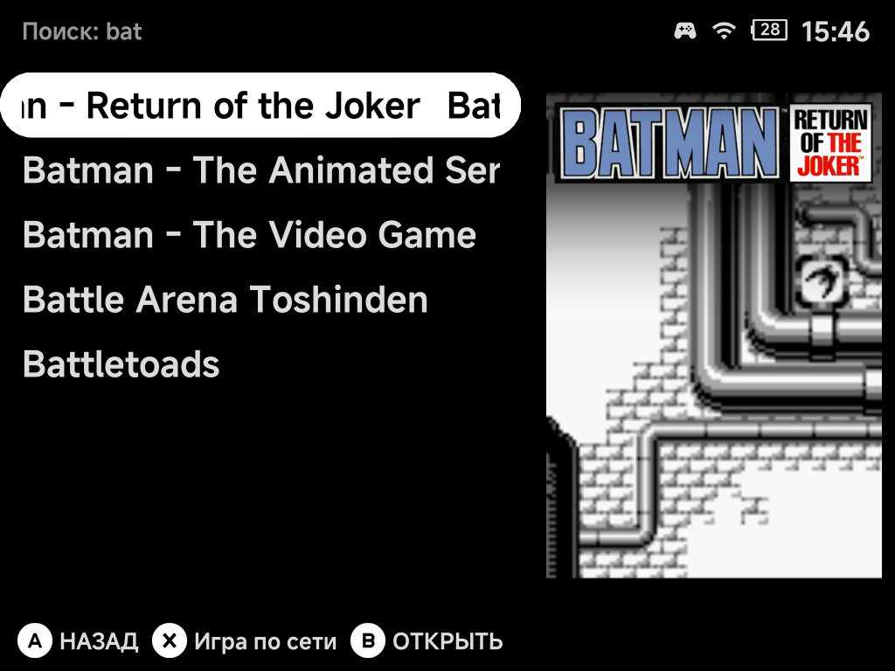

> **Language:** [Русский](README.md) · English

# [MR] NX Redux Patch (RU)


A patch for **NX Redux on the TrimUI Brick Pro** that translates the interface into Russian, replaces the boot logo and adds a few menu improvements. The patch is applied on the fly to the already installed `nextui.elf` / `settings.elf` and can be removed just as easily.

| Patcher menu | Translated game menu |
| :---: | :---: |
|  |  |

## What Does This Patch Do

- **Full Russian interface** for NextUI and Settings: main menu, tabs (CONSOLES, COLLECTIONS, TOOLS, RECENT, SEARCH), game list, game menu, every dialog (delete, rename, collections, artwork fetching), button hints and the on-screen keyboard.
- **Everything visible in the shell is translated**: Home stats, the Game Switcher (including "Today", "Yesterday", "Last week"), setting values ("List"), empty states and hints.
- **Tool names**: Artwork Manager → **Менеджер обложек**, Device Sync → **Синхронизация**, Game Tracker → **Статистика игр**, and the rest. NextUI reads them from `Tools/map.txt`; the installer appends the translations without dropping your own aliases, and removal restores the file.
- **Settings** are translated completely, including item descriptions and the simple mode help text.
- **The in-game menu** (MENU in any emulator): "Продолжить", "Сохранить", "Загрузить", "Опции", "Выход", plus "Оболочка", "Опции ядра", "Шейдеры", "Читы", "Управление", "Сочетания", "Сохранить настройки" and those submenus; the B hint reads "ВЫБРАТЬ". It lives in the shared `minarch.elf`, so it works for every console.
- **Boot logo** `Big Mr712.bmp` with a signature; the clean variant `Big` stays available in `Settings → Boot logo`.
- **Dedicated patcher menu** with a description of the selected item, black "Install / Remove / Exit" screens and wrap-around navigation.
- **Grid wrap-around**: in Tools, Consoles and Collections, pressing down on the last row moves to the first one, and up on the first row moves to the last one.
- **Search within the console**: a game-menu item (also available from the search results menu) that matches the **beginning of the game title** in the current console folder (the file extension is ignored). Back from the results returns to the search prompt with the previous query; back again returns to the game list. The keyboard shows "Поиск в консоли <console name>" (the name in white), centred hints, L1 = space, R1 = done; an empty result shows no artwork.
- **"Continue" row at the top of a console**: the first row is that console's newest game from Recents, with its cover; A launches it the same way Recents does (loading the save state when there is one). Computed once per list, with no disk access.
- **Version check**: if `version.txt` is not `NXRedux-v2.5.1`, the patch warns and offers to cancel (cancel is the default).

## Compatibility

- Device: **TrimUI Brick Pro** (any NextUI device with the same memory layout should work as well).
- Firmware: **NX Redux 2.5.1** (checked through `version.txt`).
- The patch works with the **installed** binaries: nothing is downgraded, official updates keep working.
- Official `nextui.elf` and `settings.elf` are not part of this repository — the patch is applied to the files already present on the card.
- The translation is version independent: strings are located by content. Code changes (grid wrap, console search, the "Continue" row) are build specific and are simply skipped on another version.

## Installation

1. Copy the contents of the `port` folder to the root of the SD card, keeping the structure:
   ```
   Roms/Ports (PORTS)/NX REDUX Mr712 Patch.sh
   Roms/Ports (PORTS)/.ports/nxredux-mr712/...
   ```
   The folder name may be anything (`Ports`, `PORTS`, etc.): the scripts derive their path from their own file instead of a hard-coded `Ports (PORTS)`. The folder still has to be a console NextUI lists (normally `Ports (PORTS)`), with the `.sh` next to `.ports/nxredux-mr712/`.
2. Insert the card into the console and power it on.

> To build a ready-to-copy archive, run `build.bat` in the project root: it writes `builds/NXPatch_v1.0_for_Trimui_Brick_Pro.zip`. The archive is flat (`NX REDUX Mr712 Patch.sh` plus `.ports/`), so unpack it **into the ports console folder** — under any name (`Ports (PORTS)`, `Ports`, ...). It must be the ports console: `.sh` is launched by its emulator; in a regular console (NES, GB, ...) the file shows up but will not start.
3. Open **Ports** and start **NX REDUX Mr712 Patch** (or `TOOLS → NX REDUX Mr712 Patch`).
4. Choose **Install patch** and confirm.
5. Wait for the "Done" message and reboot the console.

Safety: the first run stores `nextui.elf.before` and `settings.elf.before`; the rollback uses them.

## Removal

1. Start **NX REDUX Mr712 Patch** and choose **Remove patch**.
2. Reboot the console.

The official `nextui.elf` and `settings.elf` are restored, the original boot logo and the Settings folder name are returned. Logos added to the Settings list are kept.

## How It Works (For Developers)

The patch does not rebuild NextUI; it edits machine code inside the ELF files.

### String relocation

`nxpatch` (AArch64, static) finds the original string in `.rodata` by content, copies the translation into a new RX segment (the "cave") and rewrites every reference:

- `ADRP + ADD` pairs (including chained `ADD`s and non-chained `add Xd, Xbase, #imm`);
- eight-byte pointers in string tables.

The original strings stay in the file, which is why English labels are still visible in `strings`, while the interface already uses the Russian ones. Patched files are marked with `Mr712RU`; applying the patch twice returns code 2 ("already patched").

### Tool names

The Tools tab names are not compiled into the binary: NextUI reads them from `Tools/map.txt` on the card. The installer appends rows for the stock paks (`Artwork Manager.pak` → `Менеджер обложек`, etc.), keeping the original file as `map.txt.bak`; removal restores it (or deletes the file if it did not exist). This works on a clean card and on top of your own renames.

### In-game menu (`minarch.elf`)

The MENU overlay is drawn by the shared frontend `minarch.elf` in `.system/bin`, not by NextUI. The patch translates its strings with the same `nxpatch` (a separate `minarch.tsv`), keeping the original as `minarch.elf.before`; removal restores it. Setting values (`On/Off`, `Auto`, `Native`, `Aspect`, `High`, ...) are deliberately left as the config and the core store them: translating them would change the saved values, and removing the patch would reset those settings. Item names, descriptions and hints are translated.

### Relative dates ("Today", "Yesterday")

With LTO, GCC turns `snprintf(dst, 64, "Today")` into a fixed `strlen+1` copy, so a longer Russian string would be cut to "Сег". `nxpatch` finds the five sites (`Today`, `Yesterday`, `Last week`, `Last month`, `Last year`) by signature and replaces the copy with a call to a NUL-terminating helper; the report says `date copies 5`.

### Truncated menu labels

The compiler expands `snprintf(dst, 64, "%s", "literal")` into a fixed-length copy of `strlen(literal)+1` bytes. After replacing the literal with a longer Russian string, the label was cut in the middle of a UTF-8 sequence. `nxpatch` recognizes such copies by their shape (coverage exactly `strlen+1`, the item `id` stored at offset `0x40`) and replaces them with a call to a small helper in the cave that copies up to NUL.

### Grid wrap-around

The grid input handler contains two "stop" branches (up on the first row and down on the last row). Both are redirected to cave stubs that compute the new index and return into the common selection path. The site is found by a ten-instruction signature; on a mismatch the step is skipped.

### Console search and the "Continue" row

Both live in the same cave and are wired in through hooks on the list handler:

- **search** — a game-menu item opens the keyboard; the matches are collected
  into a regular `Directory`. Back from the results returns to the search
  prompt with the previous query; back again returns to the game list.
  Details and addresses: [docs/console_search.md](docs/console_search.md);
- **"Continue"** — the first row of a console list: that console's newest game
  from Recents. A launches it the same way Recents does (loading the save state
  when there is one). Details, measurements and pitfalls:
  [docs/continue_row.md](docs/continue_row.md).

| Console search | "Continue" row |
| :---: | :---: |
|  |  |

### Patcher menu

`mr712menu` is a small SDL2 application that draws pre-rendered BMP frames. The button layout and hint labels are read from `minuisettings.txt` (`buttonlayout`, `hintlabels`), so the menu follows the system settings instead of assuming an Xbox pad.

## Limitations

- Code patches (grid wrap, console search, the "Continue" row) are tied to a specific NX Redux build. After a firmware update, run the patch again: if the signature does not match, that step is skipped without any side effects (the log shows `grid wrap 0`, `console search 0`).
- The translation and the artwork are version independent and apply to any suitable binary.
- The patch does not touch saves, game lists, collections or user settings.

## Repository Layout

```
port/    ready-to-use set for the SD card (copy to the card root)
tools/   sources: nxpatch.c, mr712menu.c, translation tables, helper scripts
docs/    technical notes and plans
images/  screenshots used by the READMEs
```

The tools are cross-compiled for `aarch64-linux-musl`; the ready binary `nxpatch` is already inside `port`.

## Credits

The original interface and firmware belong to the NextUI and NX Redux projects. This repository contains neither of their binaries and changes nothing on the card without an explicit user command.

## License

This project is licensed under the **Apache-2.0 License**.
