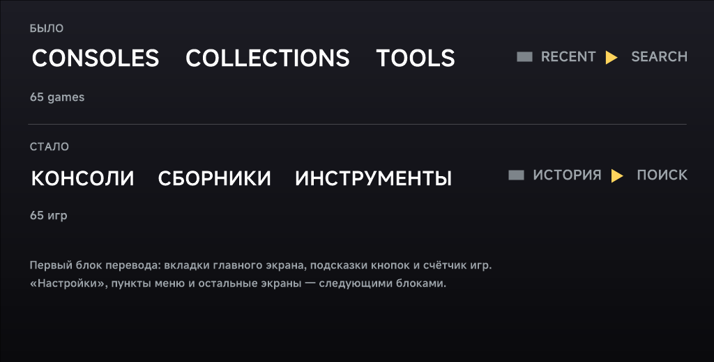
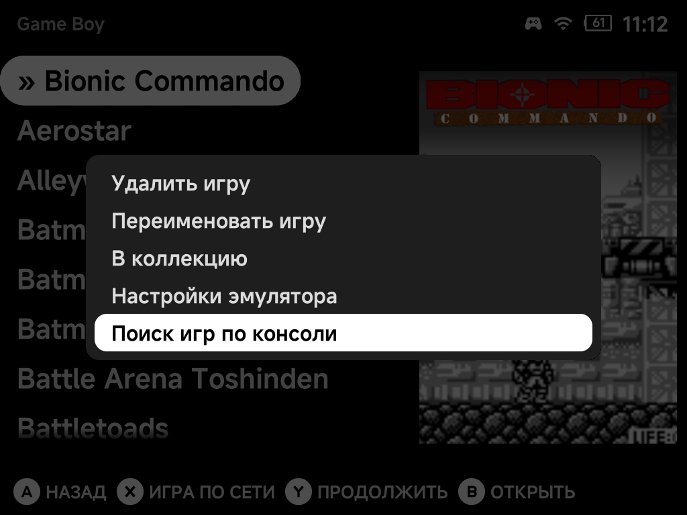
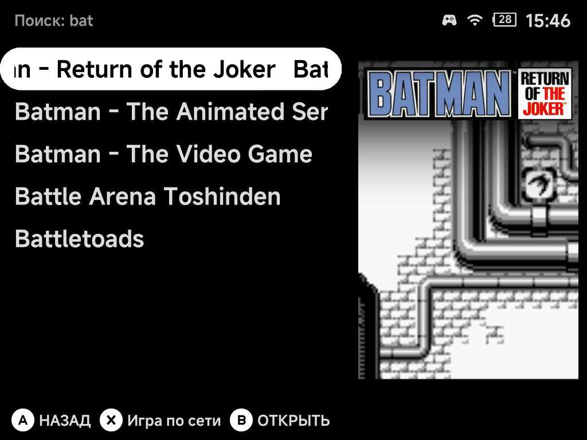
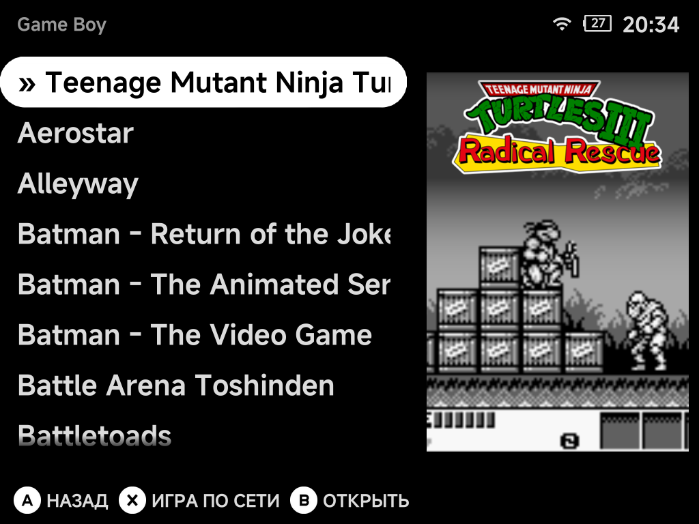

> **Language:** Русский · [English](README.en.md)

# [MR] NX Redux Patch (RU)


Патч для **NX Redux (NextUI) на TrimUI Brick Pro**, который переводит интерфейс на русский язык, меняет загрузочный логотип и добавляет несколько доработок меню. Патч накладывается «на лету» на уже установленные `nextui.elf` / `settings.elf` и так же просто снимается.

| Меню патчера | Переведённое меню игры |
| :---: | :---: |
|  |  |

## Что делает патч

- **Полный русский интерфейс** NextUI и настроек: главное меню, вкладки (КОНСОЛИ, КОЛЛЕКЦИИ, ИНСТРУМЕНТЫ, НЕДАВНИЕ, ПОИСК), список игр, меню игры, все диалоги (удаление, переименование, коллекции, загрузка обложек), подписи кнопок и клавиатура.
- **Настройки** переведены целиком, включая описания пунктов и справку простого режима.
- **Загрузочный логотип** `Big Mr712.bmp` с подписью; в списке `Настройки → Логотип при запуске` остаётся чистый вариант `Big`.
- **Собственное меню патчера** с описанием выбранного пункта, чёрными экранами «Установка/Удаление/Выход» и навигацией по кругу.
- **Зацикливание сетки**: в Инструментах, Консолях и Коллекциях нажатие вниз на последней строке переводит на первую, вверх на первой — на последнюю.
- **Поиск игры в консоли**: пункт в меню игры; ищет по **началу названия** игры в текущей папке консоли, расширение файла не учитывается. Назад из результатов возвращает в поиск с прошлым запросом, повторный назад — в список игр.
- **«Продолжить» в начале консоли**: первая строка списка — самая свежая игра этой консоли из «Недавних», с обложкой; A запускает её как из «Недавних» (с загрузкой сейва, если он есть). Считается один раз на список, без обращений к диску.
- **Проверка версии**: если в `version.txt` не `NXRedux-v2.5.1`, патч предупредит и предложит отменить установку (по умолчанию).

## Совместимость

- Устройство: **TrimUI Brick Pro** (в перспективе — любая консоль на NextUI с той же раскладкой памяти).
- Прошивка: **NX Redux 2.5.1** (проверяется по `version.txt`).
- Патч работает с **установленными** бинарниками: ничего не откатывается на старую версию, обновляться можно штатно.
- Официальные `nextui.elf` и `settings.elf` в репозиторий не входят — патч применяется к тому, что уже лежит на карте.
- Перевод не зависит от версии: строки ищутся по содержимому. Правки кода (зацикливание сетки, поиск по консоли, строка «Продолжить») привязаны к сборке и на другой версии просто не применяются.

## Установка

1. Скопируйте содержимое папки `port` в корень карты памяти, сохранив структуру:
   ```
   Roms/Ports (PORTS)/NX REDUX Mr712 Patch.sh
   Roms/Ports (PORTS)/.ports/nxredux-mr712/...
   ```
2. Вставьте карту в консоль и включите её.
3. Откройте **Порты** и запустите **NX REDUX Mr712 Patch** (или `ИНСТРУМЕНТЫ → NX REDUX Mr712 Patch`).
4. Выберите **Установка патча** и подтвердите.
5. Дождитесь сообщения «Готово» и перезагрузите консоль.

Приложение безопасности: первый запуск сохраняет копии `nextui.elf.before` и `settings.elf.before` — по ним выполняется откат.

## Удаление

1. Запустите **NX REDUX Mr712 Patch** и выберите **Удаление патча**.
2. Перезагрузите консоль.

Будут восстановлены официальные `nextui.elf` и `settings.elf`, возвращён исходный загрузочный логотип и имя папки настроек. Добавленные в список логотипы остаются на месте.

## Как это работает (для разработчиков)

Патч не пересобирает NextUI, а правит машинный код в ELF-файлах.

### Перенос строк

`nxpatch` (AArch64, статический) находит исходную строку в `.rodata` по содержимому, копирует перевод в новый RX-сегмент («кейв») и переписывает все ссылки:

- пары `ADRP + ADD` (включая цепочки `ADD` и нецепочечные `add Xd, Xbase, #imm`);
- восьмибайтовые указатели в таблицах строк.

Исходные строки остаются в файле, поэтому английские надписи видны в `strings`, но интерфейс использует уже русские. Файлы помечаются маркером `Mr712RU`, повторное применение возвращает код 2 («уже пропатчено»).

### Обрезанные метки меню

Компилятор разворачивает `snprintf(dst, 64, "%s", "литерал")` в копию фиксированной длины `strlen(литерала)+1`. После подмены литерала на длинную русскую строку метка обрезалась посреди UTF-8. `nxpatch` находит такие копии по шаблону (покрытие ровно `strlen+1`, запись `id` по смещению `0x40`) и заменяет их вызовом небольшого помощника в кейве, копирующего до NUL.

### Зацикливание сетки

В обработчике сетки находятся две ветви «стоп» (вверх с первой строки и вниз с последней). Обе перенаправляются на заглушки в кейве, которые считают новый индекс и возвращаются в общий путь выбора. Поиск выполняется по сигнатуре из десяти инструкций; при несовпадении патч пропускается.

### Поиск игры в консоли и строка «Продолжить»

Обе функции живут в том же кейве и подключаются хуками к обработчику списка:

- **поиск** — пункт меню игры открывает клавиатуру, результаты собираются в
  обычный `Directory`; назад из результатов возвращает в поиск с прошлым
  запросом, повторный назад — в список игр. Детали и адреса:
  [docs/console_search.md](docs/console_search.md);
- **«Продолжить»** — первая строка списка консоли: самая свежая игра этой
  консоли из «Недавних». A запускает её так же, как «Недавние» (с загрузкой
  сейва, если он есть). Детали, замеры и грабли:
  [docs/continue_row.md](docs/continue_row.md).

| Поиск в консоли | Строка «Продолжить» |
| :---: | :---: |
|  |  |

### Меню патчера

`mr712menu` — отдельное приложение на SDL2, рисует заранее подготовленные BMP-кадры. Раскладка кнопок и подписи подсказок читаются из `minuisettings.txt` (`buttonlayout`, `hintlabels`), поэтому меню следует системным настройкам, а не жёстко заданной раскладке Xbox.

## Ограничения

- Правки кода (зацикливание сетки, поиск по консоли, строка «Продолжить») привязаны к конкретной сборке NX Redux. После обновления прошивки запустите патч заново: если сигнатура не совпадёт, патч пропустит этот шаг без последствий (в логе `grid wrap 0`, `console search 0`).
- Перевод и оформление от версии не зависят и применяются к любому подходящему бинарнику.
- Патч не трогает сохранения, список игр, коллекции и настройки пользователя.

## Структура репозитория

```
port/    готовый набор для карты памяти (скопировать в корень)
tools/   исходники: nxpatch.c, mr712menu.c, строки перевода, вспомогательные скрипты
docs/    технические заметки и планы
images/  скриншоты для README
```

Сборка инструментов выполняется кросс-компилятором (`aarch64-linux-musl`); готовый `nxpatch` уже лежит в `port`.

## Благодарности

Оригинальный интерфейс и прошивка — проекты NextUI и NX Redux. Патч не содержит их бинарников и не изменяет файлы на карте без явной команды пользователя.

## Лицензия

Проект распространяется под лицензией **Apache-2.0**.
