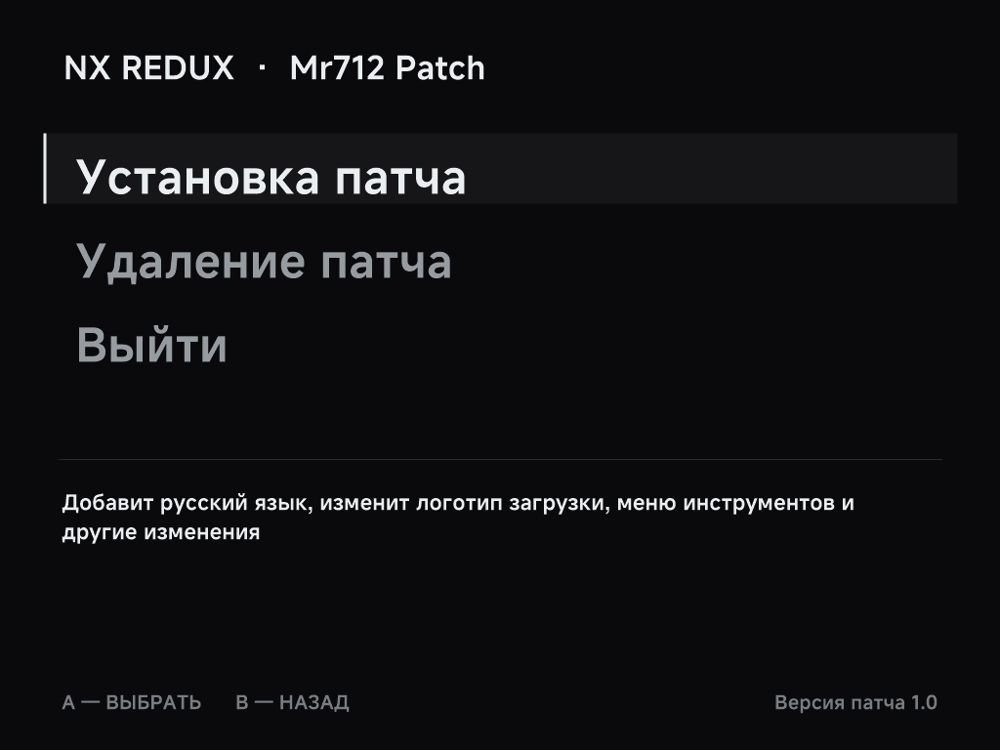
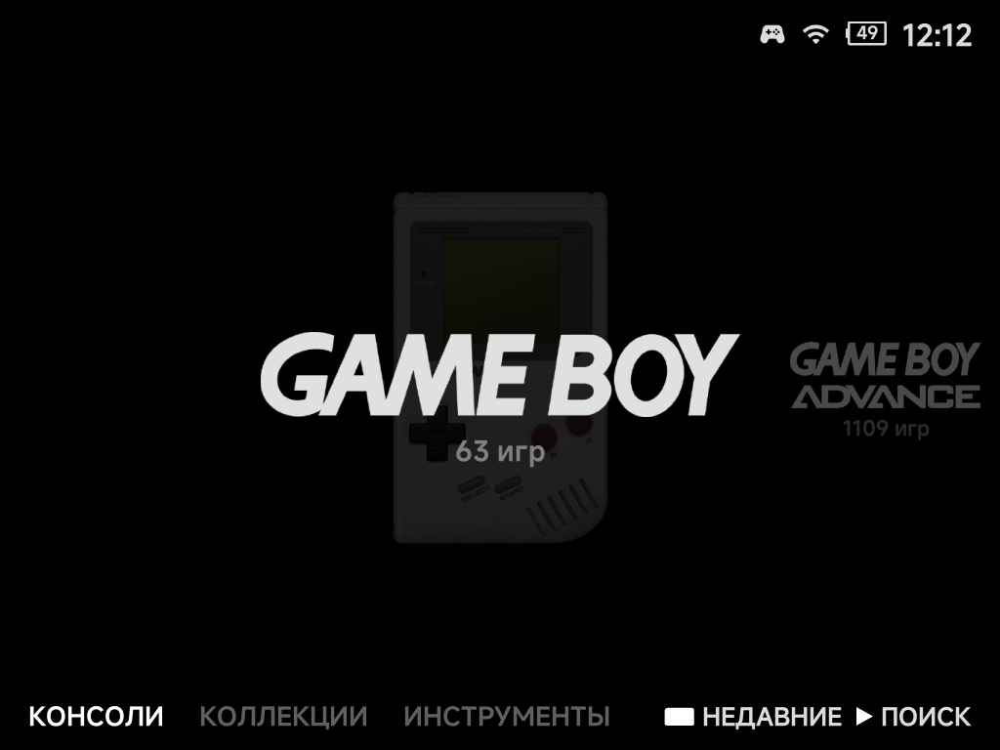
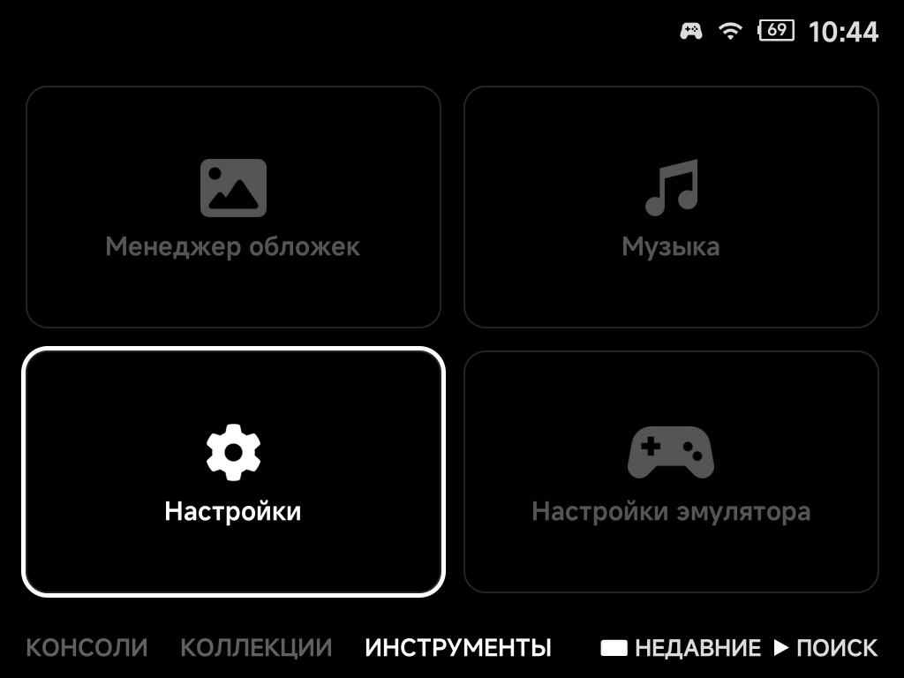
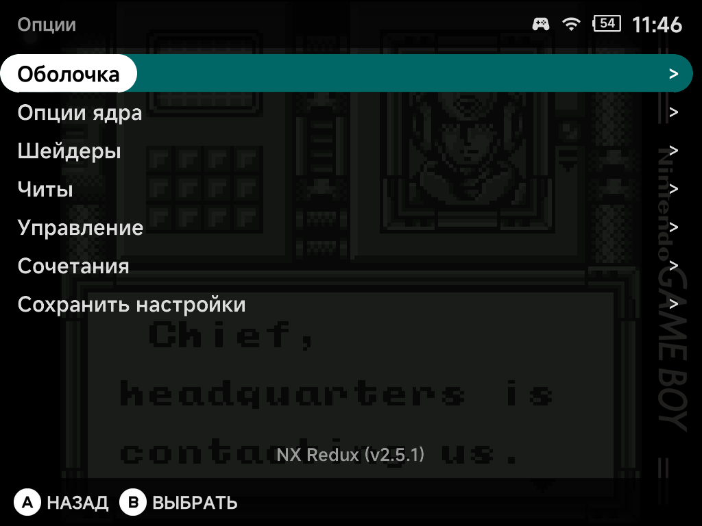
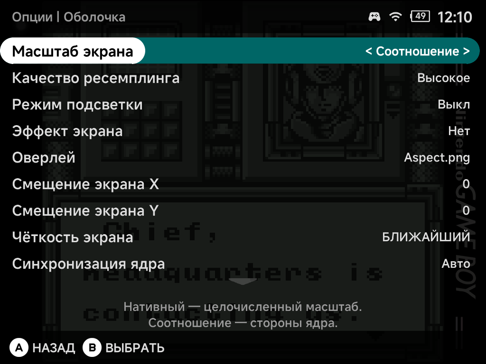
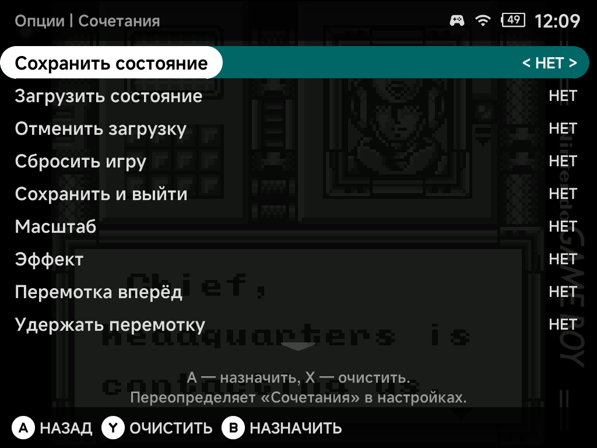
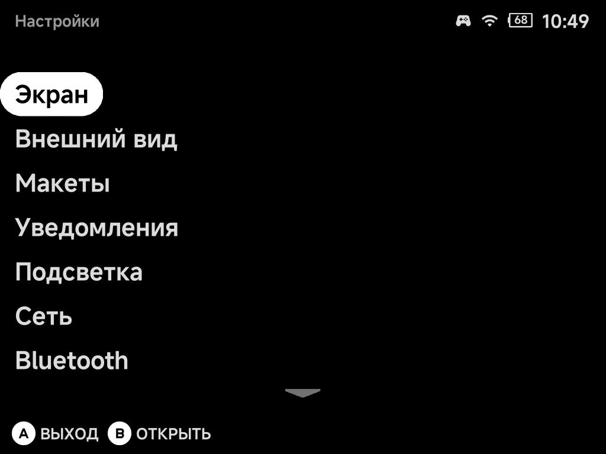
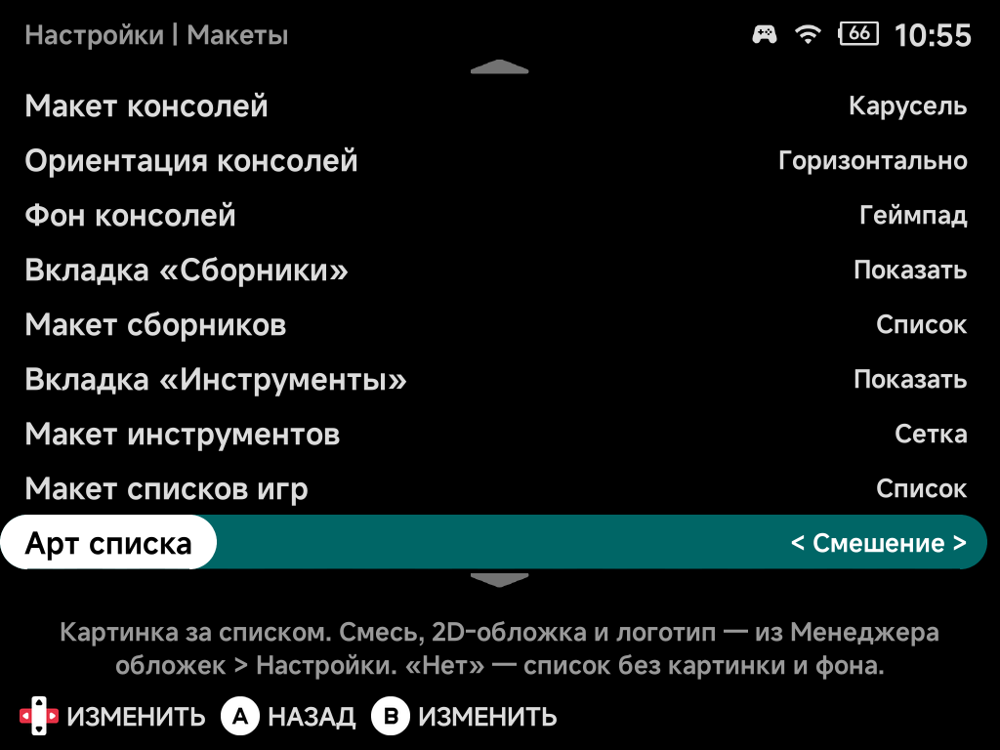

> **Language:** Русский · [English](README.en.md)

# NX Redux Patch


Патч для **NX Redux на TrimUI Brick Pro**, который переводит интерфейс на русский язык, меняет загрузочный логотип и добавляет несколько доработок меню. Патч накладывается «на лету» на уже установленные `nextui.elf` / `settings.elf` и так же просто снимается.

| Меню патчера | Главный экран |
| :---: | :---: |
|  |  |

## Что делает патч

- Изменён загрузочный логотип.
- Перевод прошивки на русский.
- В виртуальной клавиатуре добавлено управление с кнопок для «ПРОБЕЛ» и «ГОТОВО» — L1 и R1 соответственно.
- Добавлен поиск в списке игр конкретной консоли: в списке игр нажмите кнопку **MENU** и в открывшемся списке выберите **«Поиск игр по консоли»**.
- Добавлено продолжение игры с того места, где остановились, для каждой консоли. Самым первым пунктом в списке игр будет игра, в которую вы играли последний раз на этой консоли.
- В списке инструментов добавлена прокрутка через верхнюю и нижнюю грань.

## Скриншоты

Все снимки — полный экран консоли 1024×768, без обрезки.

### Главный экран и инструменты

| Главный экран | Менеджер обложек |
| :---: | :---: |
|  |  |

| Синхронизация | Меню игры |
| :---: | :---: |
|  |  |

Сетка «Инструментов», «Консолей» и «Коллекций» зациклена: вниз с последней строки ведёт на первую, вверх с первой — на последнюю.

### Поиск по консоли

| Клавиатура | Результаты |
| :---: | :---: |
|  |  |

### «Продолжить»


### Внутриигровое меню

| Главное меню | Опции |
| :---: | :---: |
|  |  |

| Оболочка | Сочетания |
| :---: | :---: |
|  |  |

### Настройки

| Настройки | Макеты |
| :---: | :---: |
|  |  |

### Логотип и патчер

| Логотип загрузки | Меню патчера |
| :---: | :---: |
|  |  |

## Совместимость

- Устройство: **TrimUI Brick Pro**.
- Прошивка: **NX Redux 2.5.1**.
- Патч работает с **установленными** бинарниками.

## Установка

1. Скопируйте содержимое [скачанного архива](https://github.com/byMr712/NXPatch-TrimuiBrickPro/releases) в папку портов, у вас должна получиться примерно такая структура:
   ```
   Roms/Ports (PORTS)/NX REDUX Mr712 Patch.sh
   Roms/Ports (PORTS)/.ports/nxredux-mr712/...
   ```
   Имя папки может быть любым (`Ports`, `PORTS`, `Порты` и т.п.): скрипты берут путь от своего файла, а не из жёстко прописанного `Ports (PORTS)`. Важно только, чтобы NX Redux видел эту папку как консоль (штатно — `Ports (PORTS)`) и сохранялась структура: `.sh` рядом с `.ports/nxredux-mr712/`.
2. Вставьте карту в консоль и включите её.
3. Откройте **Порты** и запустите **NX REDUX Mr712 Patch** (или `ИНСТРУМЕНТЫ → NX REDUX Mr712 Patch`).
4. Выберите **Установка патча** и подтвердите.
5. Дождитесь сообщения «Готово» и перезагрузите консоль.

Приложение безопасности: первый запуск сохраняет копии `nextui.elf.before` и `settings.elf.before` — по ним выполняется откат.

## Удаление

1. Запустите **NX REDUX Mr712 Patch** и выберите **Удаление патча**.
2. Перезагрузите консоль.

Будут восстановлены официальные `nextui.elf` и `settings.elf`, возвращён исходный загрузочный логотип и имя папки настроек. Добавленные в список логотипы остаются на месте.

## Как это работает (для разработчиков)

Патч не пересобирает NX Redux, а правит машинный код в ELF-файлах.

### Перенос строк

`nxpatch` (AArch64, статический) находит исходную строку в `.rodata` по содержимому, копирует перевод в новый RX-сегмент («кейв») и переписывает все ссылки:

- пары `ADRP + ADD` (включая цепочки `ADD` и нецепочечные `add Xd, Xbase, #imm`);
- восьмибайтовые указатели в таблицах строк.

Исходные строки остаются в файле, поэтому английские надписи видны в `strings`, но интерфейс использует уже русские. Файлы помечаются маркером `Mr712RU`, повторное применение возвращает код 2 («уже пропатчено»).

### Названия инструментов

Имена вкладок «Инструменты» NX Redux читает не из бинарника, а из `Tools/map.txt` на карте. Установщик добавляет туда строки для штатных паков (`Artwork Manager.pak` → `Менеджер обложек` и т.д.), предварительно сохранив исходный файл в `map.txt.bak`; при удалении файл восстанавливается (а если его не было — просто удаляется). Поэтому патч работает и на чистой карте, и поверх ваших переименований.

### Внутриигровое меню (`minarch.elf`)

Меню по кнопке MENU рисует не NX Redux, а общий фронтенд `minarch.elf` в `.system/bin`. Патч переводит его строки тем же `nxpatch` (отдельный `minarch.tsv`), сохраняя исходник в `minarch.elf.before`; удаление возвращает его.

Подменю «Оболочка», «Шейдеры», «Управление» и «Сочетания» переведены внутри. Для значений, которые одновременно являются ключами конфига, используется отдельная таблица `minarch_display.tsv`: она подменяет только отображаемые указатели (`labels`, имена сочетаний, `button_labels`), а сохраняемые значения остаются английскими. Поэтому настройки и привязки кнопок не ломаются, а после снятия патча конфиги читаются штатной сборкой. Исключение — «Опции ядра»: там переведено только название, пункты и их значения приходят от самого ядра. Названия кнопок в «Управлении» тоже приходят от ядра (A Button, A Turbo и т.п.) и остаются как есть.

### Относительные даты («Сегодня», «Вчера»)

GCC при LTO разворачивает `snprintf(dst, 64, "Today")` в копию фиксированной длины `strlen+1`, поэтому длинная русская строка обрезалась бы до «Сег». `nxpatch` находит пять таких мест (`Today`, `Yesterday`, `Last week`, `Last month`, `Last year`) по сигнатуре и заменяет копирование вызовом помощника, который копирует до NUL; в отчёте это `date copies 5`.

### Обрезанные метки меню

Компилятор разворачивает `snprintf(dst, 64, "%s", "литерал")` в копию фиксированной длины `strlen(литерала)+1`. После подмены литерала на длинную русскую строку метка обрезалась посреди UTF-8. `nxpatch` находит такие копии по шаблону (покрытие ровно `strlen+1`, запись `id` по смещению `0x40`) и заменяет их вызовом небольшого помощника в кейве, копирующего до NUL.

### Зацикливание сетки

В обработчике сетки находятся две ветви «стоп» (вверх с первой строки и вниз с последней). Обе перенаправляются на заглушки в кейве, которые считают новый индекс и возвращаются в общий путь выбора. Поиск выполняется по сигнатуре из десяти инструкций; при несовпадении патч пропускается.

### Поиск игры в консоли и строка «Продолжить»

Обе функции живут в том же кейве и подключаются хуками к обработчику списка:

- **поиск** — пункт меню игры открывает клавиатуру, результаты собираются в
  обычный `Directory`; назад из результатов возвращает в поиск с прошлым
  запросом, повторный назад — в список игр. Детали и адреса:
  [docs/console_search.md](docs/console_search.md);
- **«Продолжить»** — первая строка списка консоли: самая свежая игра этой
  консоли из «Недавних». A запускает её так же, как «Недавние» (с загрузкой
  сейва, если он есть). Детали, замеры и грабли:
  [docs/continue_row.md](docs/continue_row.md).

Скриншоты клавиатуры и результатов — в разделе [«Скриншоты»](#скриншоты).

### Меню патчера

`mr712menu` — отдельное приложение на SDL2, рисует заранее подготовленные BMP-кадры. Раскладка кнопок и подписи подсказок читаются из `minuisettings.txt` (`buttonlayout`, `hintlabels`), поэтому меню следует системным настройкам, а не жёстко заданной раскладке Xbox.

## Ограничения

- Правки кода (зацикливание сетки, поиск по консоли, строка «Продолжить») привязаны к конкретной сборке NX Redux. После обновления прошивки запустите патч заново: если сигнатура не совпадёт, патч пропустит этот шаг без последствий (в логе `grid wrap 0`, `console search 0`).
- Перевод и оформление от версии не зависят и применяются к любому подходящему бинарнику.
- Патч не трогает сохранения, список игр, коллекции и настройки пользователя.

## Структура репозитория

```
port/    готовый набор для карты памяти (скопировать в корень)
tools/   исходники: nxpatch.c, mr712menu.c, строки перевода, вспомогательные скрипты
docs/    технические заметки и планы
images/  скриншоты для README
```

Сборка инструментов выполняется кросс-компилятором (`aarch64-linux-musl`); готовый `nxpatch` уже лежит в `port`.

## Благодарности

Оригинальный интерфейс и прошивка принадлежат проекту [NX Redux](https://github.com/nx-redux/nx-handheld). Патч не содержит его бинарников и не изменяет файлы на карте без явной команды пользователя.

## Лицензия

Проект распространяется под лицензией **Apache-2.0**.
