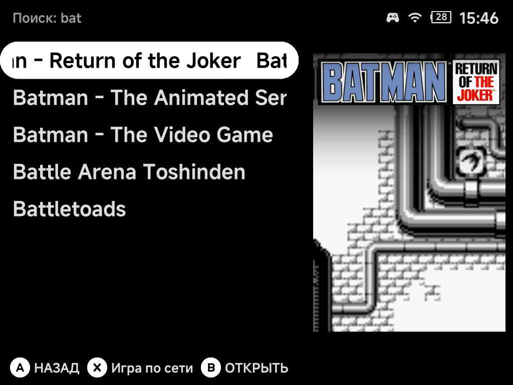

# «Поиск игры в консоли» — реализация

Дата: 2026-11-26. Статус: работает на консоли, проверено запросами `b` и `bat`
(в результатах только игры, чьё название начинается с этих букв).

## Что делает

В меню игры (MENU на строке игры внутри `Roms/<консоль>`) появляется пункт
**«Поиск игры в консоли»** (id 42). Он:

1. Открывает штатную клавиатуру NextUI (тот же виджет, что в Wi-Fi и
   переименовании) с заголовком «Поиск в консоли».
2. Берёт **текущий список консоли** (`top`, включая подпапку, если поиск
   открыт в ней) и оставляет записи, у которых **отображаемое имя начинается
   с запроса** (без учёта регистра).
3. Создаёт обычный `Directory` с заголовком «Поиск: <запрос>» и кладёт его
   в стек — список рисуется штатным рендером игр, B возвращает назад.

Расширение файла не участвует: запрос `b` больше не совпадает со всеми
Game Boy ROM из-за `.gb`. Глобальный индекс ROM тоже не используется —
поиск идёт только по текущей папке консоли.

## Чего здесь нет

- Оригинальный `Search_open` не вызывается — ни целиком, ни куском.
  Вклеенный в `GameList_handleInput` блок поиска не трогается.
- Нет буквенных прыжков L1/R1 в результатах: `alphas.count` очищается,
  `entry->alpha` устанавливается в 0. Для короткого списка результатов это
  не нужно; при желании можно пересчитать альфу по первой букве имени.

## Как устроено в кейве

Функция `build_console_search` в `tools/nxpatch.c` собирает:

| часть | назначение |
|---|---|
| обработчик id 42 | `cmp w0,#42`; сохраняет `x29/x30`, вызывает поиск, возвращается; для остальных id — оригинальный пролог `GameList_runContextAction` |
| пункт меню (2 точки вставки) | `addItem(..., "Поиск игры в консоли", 42)` в `GameList_openContextMenuFor` и в инлайн-копии меню; гейт: запись — ROM или folder-game, `top->path` начинается с `/mnt/SDCARD/Roms/` |
| поиск | клавиатура → `search_query` → пустой `Directory` → копии подходящих `Entry` → push/top |

Копии записей делаются через `Entry_newNamed(path, type, name)` плюс
`strdup(unique)`: список консоли не разделяет `Entry` с результатами, поэтому
B и `Directory_free` не портят исходный список. Заголовок и путь результата —
`Directory_new("/tmp/.nxsearch", 0)` (пустая папка, быстрый `getEntries`),
затем `path` заменяется на `FAUX_SEARCH_PATH`, а `name` — на «Поиск: q».

## Ошибки, которые были по пути

1. **Заглушка обработчика без сохранения `x30`.** В первой версии было
   `bl search; ret`: `bl` затирал `x30`, и `ret` возвращался в сам себя —
   лаунчер зависал после создания списка. Лечится `stp x29,x30` вокруг вызова.
2. **Функции поиска и фильтра без сохранения `x30`.** `bl strlen/strncmp/
   Entry_free` затирали `x30`, и `ret` уходил в мусор — падение при нажатии
   «Готово». Теперь `x30` сохраняется в кадре и восстанавливается перед `ret`.
3. **Фильтр по префиксу пути + глобальный поиск.** Давал правильную папку, но
   совпадение по имени файла с расширением (`.gb`). Заменён на поиск по
   префиксу отображаемого имени в текущем списке.

## Адреса (nextui.elf 2.5.1)

| что | адрес |
|---|---|
| `GameList_openContextMenuFor`, вставка пункта | 0x41c820 / 0x41c910 |
| инлайн-копия меню, вставка | 0x41e3b8 |
| `GameList_runContextAction` | 0x49c330 |
| `addItem` | 0x41c7b0 |
| `entryFolderGame` | 0x496cb0 |
| `UIKeyboard_openWith` | 0x429c60 |
| `Directory_new` | 0x4a7b00 |
| `Array_push` / `Array_new` / `EntryArray_free` | 0x4ace30 / 0x4ad150 / 0x4acd00 |
| `Entry_newNamed` / `Entry_free` | 0x4adac0 / 0x4acea0 |
| `GameList_rowCountAt` | 0x497370 |
| `PLAT_clearLayers` / `ScrollText_clear` / `readyResume` | 0x4117d0 / 0x40c6f0 / 0x4a6200 |
| `top` / `stack` / `search_query` | 0x4d8da0 / 0x4d8e80 / 0x510430 |
| `FAUX_SEARCH_PATH` | 0x4ae930 |
| PLT: `snprintf` 0x406710, `free` 0x407350, `strlen` 0x4074c0, `strncmp` 0x406b30, `strncasecmp` 0x406720, `strdup` 0x407200 | — |

Структуры: `Entry{path 0, name 8, unique 0x10, type 0x18, alpha 0x1c}`;
`Directory{path 0, name 8, entries 0x10, alphas 0x18, selected 0x8c, start 0x90, end 0x94, serial 0x98}`;
`Array{count 0, capacity 4, items 8}`.

## Проверка

- `nextui.elf` после патча: `06ea4096a15ddbb6c254ff2f009fd0a6`
  (сборка 2.5.1 + перевод + сетка + поиск).
- Запрос `b`: Batman, Battle Arena Toshinden, Battletoads, Binding of Isaac,
  Bionic Commando, Black Castle. Aerostar и Alleyway отсутствуют.
- Запрос `bat`: только Batman (3) и Battle Arena Toshinden / Battletoads.
- PID лаунчера не меняется, `dmesg` без `fatal signal`.

